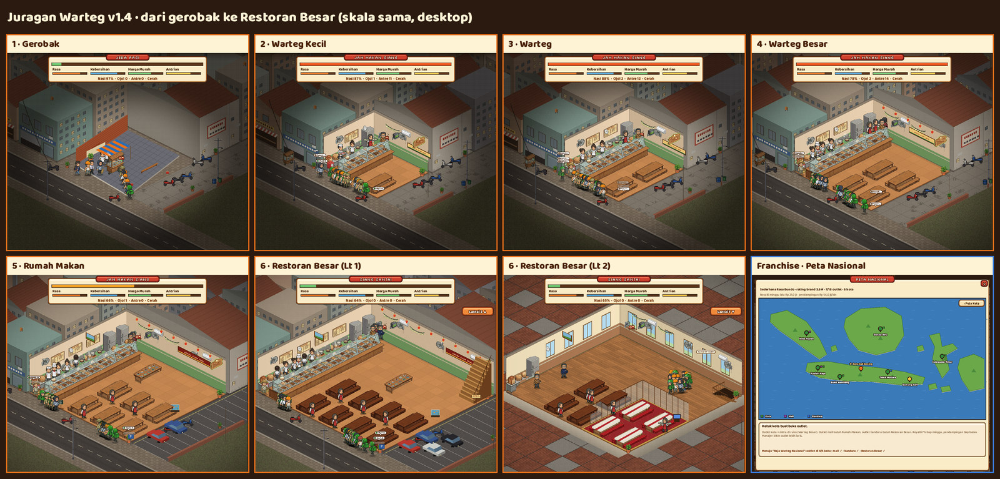
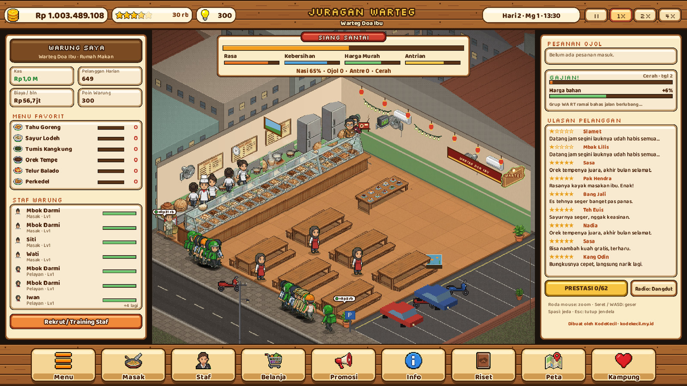
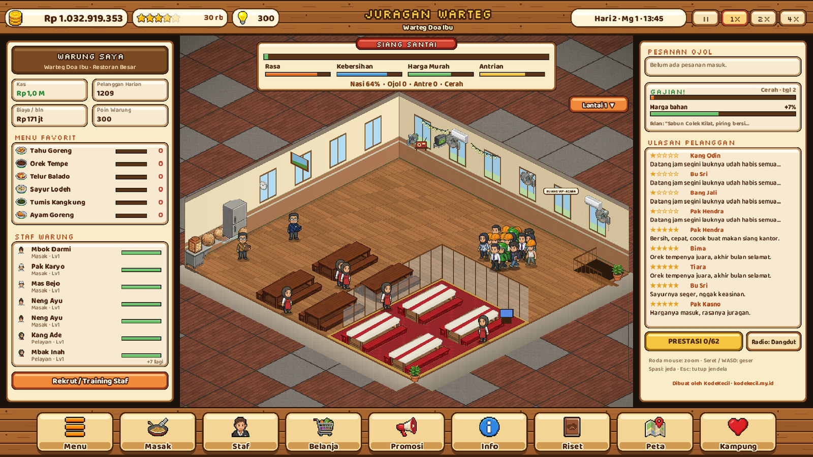
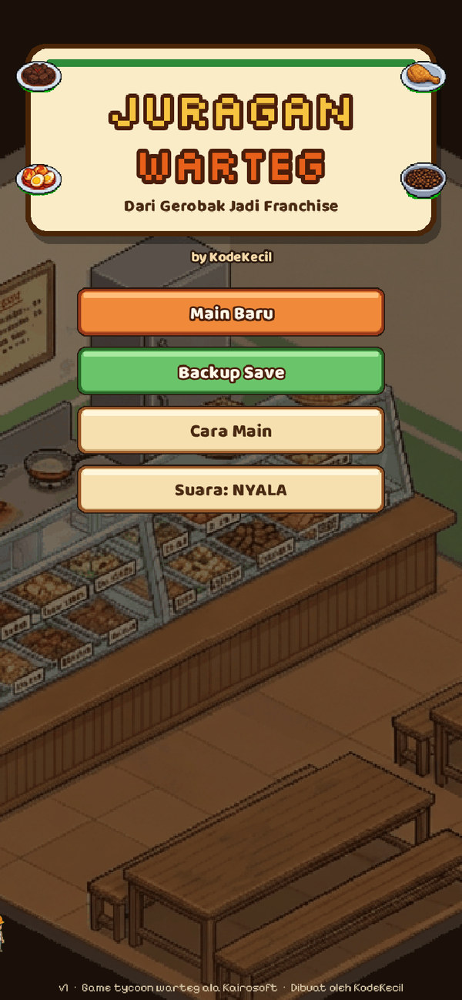
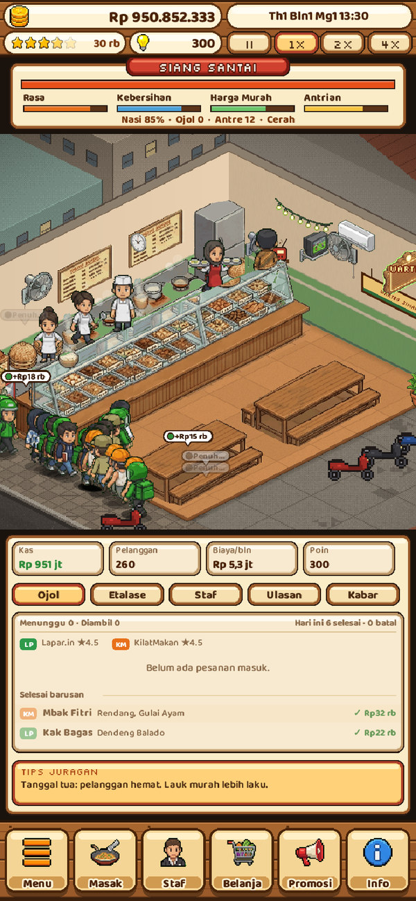
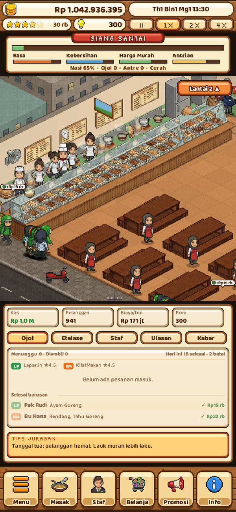
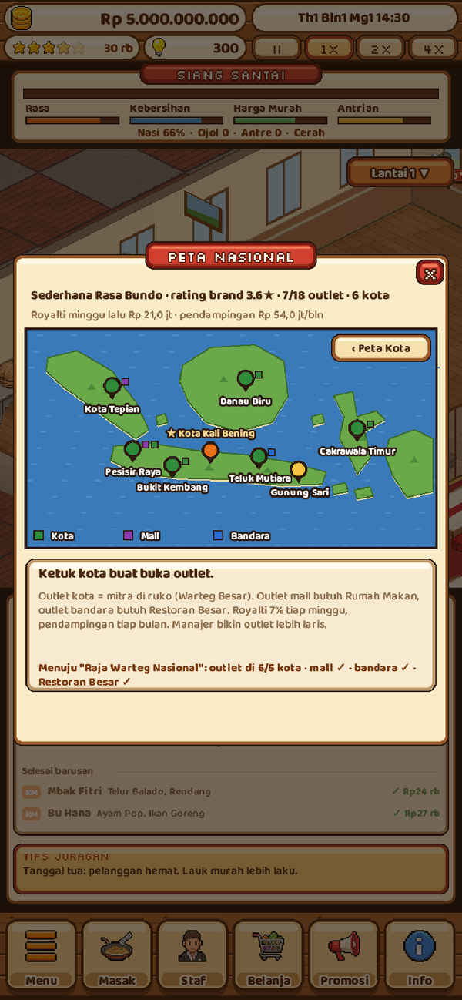

<div align="center">

[English](README.md) · **Bahasa Indonesia**

# Juragan Warteg

**Dari gerobak di pinggir pasar sampai franchise warteg se-Nusantara. Game tycoon pixel art yang bisa langsung dimainkan di browser.**

[](https://www.typescriptlang.org/)
[](https://phaser.io/)
[](https://vite.dev/)
[](#pasang-sebagai-aplikasi)
[](LICENSE)
[](https://juraganwarteg.kodekecil.my.id)

### [▶ Main sekarang](https://juraganwarteg.kodekecil.my.id)



</div>

## Tentang

Juragan Warteg adalah game manajemen ala Kairosoft tentang ngurus warteg. Kamu mulai dari gerobak di pinggir pasar, lalu naik kelas lewat enam tahap: Warteg Kecil, Warteg, Warteg Besar, Rumah Makan, sampai Restoran Besar dua lantai. Setelah itu buka cabang di seluruh kota, bikin franchise dengan brand sendiri, dan buka outlet di delapan kota.

Satu karier berjalan sepuluh tahun dalam game dan ditutup dengan gelar sesuai gaya mainmu, lalu bisa lanjut main bebas. Bahasa di dalam game santai ala obrolan sehari-hari. Semua nama usaha, aplikasi dan brand di game ini fiktif.

## Tangkapan layar

<table>
  <tr>
    <td colspan="2"></td>
    <td colspan="2"></td>
  </tr>
  <tr>
    <td></td>
    <td></td>
    <td></td>
    <td></td>
  </tr>
</table>

## Fitur

- **Sehari-hari kayak warteg beneran.** Belanja ke pasar subuh-subuh, masak lauk ke etalase, lalu hadapi sarapan, *Jam Makan Siang* dan makan malam. Pelanggan antre, pilih lauk, makan di tempat atau bungkus, dan pergi sambil kesal kalau kelamaan nunggu atau lauknya habis.
- **Enam ruangan yang benar-benar tumbuh.** Tiap tahap disusun prosedural dari satu layout: depan lebih lebar, etalase lebih panjang, dapur, meja dan antrean bertambah. Restoran Besar punya dua lantai, Ruang VIP dan parkiran.
- **Masak dan belanja.** Atur porsi sampai 32 lauk, nasi, kapasitas dapur dan sisa makanan. Harga bahan naik turun tiap minggu (cabai mahal pas musim hujan, telur dan daging naik jelang Lebaran), bahan bisa basi, gudang ada batasnya.
- **Pelanggan dengan isi dompet masing-masing.** Buruh, mahasiswa, pegawai kantor, driver ojol, mandor dan ibu-ibu, masing-masing punya budget, kesabaran dan selera. Daya beli ikut tanggal: tanggal tua lawan gajian, plus kebijakan kasbon.
- **Aplikasi ojol.** Dua aplikasi fiktif lengkap dengan biaya daftar, komisi, promo ongkir, rating toko dan driver yang datang ambil pesanan.
- **Staf berkarakter.** Juru masak, kepala dapur, kasir, pelayan, tukang belanja dan manajer, dengan skill, level dan sifat. Ada training, naik gaji, libur, THR jelang Lebaran, dibajak saingan, sampai drama cinlok.
- **Riset dan combo.** Buka resep dan teknik baru, temukan paket tiga lauk rahasia.
- **Cabang dan franchise nasional.** Delapan lokasi di kota dengan campuran pelanggan berbeda, lalu brand sendiri dengan outlet kota, mall dan bandara di delapan kota.
- **Lingkungan yang hidup.** Cuaca, Ramadan dan Lebaran, sidak Dinas Kesehatan, food vlogger, pesanan katering, pelanggan langganan dengan cerita sendiri, kucing warteg, pengamen, radio dengan lagu dangdut chiptune orisinal, dan tiga mini-game dapur.
- **Karier sepuluh tahun dengan ending bercabang,** 62 prestasi, tutorial terpandu, dan backup save lewat file atau kode.
- **Main di mana saja.** Layout responsif untuk HP dan layar lebar, bisa diinstal sebagai PWA dan dimainkan offline.

## Cara main

1. **Pagi:** cek rencana *Masak* dan harga di *Belanja*. Masak secukupnya sesuai selera pelanggan, jangan sampai banyak sisa.
2. **Jualan:** pantau antrean saat jam makan siang. Rekrut dan latih staf biar kasir nggak keteteran.
3. **Malam:** baca laporan harian dan ulasan, lalu atur harga, promosi dan menu.
4. **Naik kelas:** pakai uang, bintang dan fans untuk renovasi, dekorasi dan riset. Buka cabang dari *Peta*, lalu bangun franchise.
5. **Jaga kas:** utang dalam di tiga awal bulan berturut-turut artinya bangkrut.

Tutorial akan memandu hari pertamamu. Bisa diulang dari *Menu*.

## Kontrol

| Aksi | Desktop | HP |
|---|---|---|
| Zoom | Roda mouse | Cubit (pinch) |
| Geser kamera | Seret, tombol panah atau WASD | Seret |
| Jeda / lanjut | Spasi | Tombol kecepatan |
| Tutup dialog | Esc | Tombol ✕ |
| Lainnya | Klik bar bawah dan panel samping | Ketuk bar bawah dan tab dock |

## Teknologi

- [Phaser 4](https://phaser.io/) untuk rendering, input dan scene
- [TypeScript 7](https://www.typescriptlang.org/) mode strict, dicek dengan `tsc --noEmit`
- [Vite 8](https://vite.dev/) dengan [vite-plugin-pwa](https://vite-pwa-org.netlify.app/) (precache offline, manifest) dan [vite-plugin-singlefile](https://github.com/richardtallent/vite-plugin-singlefile) untuk build satu file
- Semua musik dan efek suara disintesis dengan WebAudio, tanpa file audio
- [Playwright](https://playwright.dev/) untuk tes end-to-end, responsif, gerakan karakter dan soak
- Python (Pillow, NumPy, SciPy) untuk pipeline sprite
- Font: Pixelify Sans, Silkscreen dan Baloo 2 lewat Fontsource

## Struktur proyek

```
juragan-warteg/
├── index.html
├── public/              # _headers (CSP dan cache), ikon PWA
├── src/
│   ├── main.ts          # boot, skala responsif
│   ├── scenes/          # Boot, Title, Game
│   ├── sim.ts           # simulasi murni (tanpa Phaser): hari, pelanggan, uang, event
│   ├── sim3.ts systems.ts   # sistem lanjutan: role, prasmanan, franchise, pajak, katering...
│   ├── data*.ts         # lauk, bahan, pelanggan, tahap, kota, ending
│   ├── layout.ts room.ts world.ts backdrop.ts   # ruangan prosedural, pathfinding, jalanan
│   ├── screens*.ts sidepanel.ts ui.ts tutorial.ts   # dialog dan UI kit
│   ├── state.ts sanitize.ts backup.ts           # format save, migrasi, impor/ekspor backup
│   ├── audio.ts         # sequencer WebAudio dan SFX
│   └── assets/          # sprite sheet
├── tools/               # skrip e2e dan screenshot, bot balance, pipeline aset, helper deploy
├── vite.config.ts       # build PWA
├── vite.single.config.ts    # build satu file
└── wrangler.embed.jsonc # konfigurasi Cloudflare Worker
```

## Mulai

Butuh Node.js 20.19 atau lebih baru.

```bash
git clone https://github.com/vhmns14/juragan-warteg.git
cd juragan-warteg
npm install
npm run dev          # server lokal dengan hot reload
npm run typecheck    # cek TypeScript strict
npm run build        # build PWA produksi ke dist/
npm run preview      # jalankan hasil build
npm run build:single # seluruh game dalam satu file HTML, di dist-single/
```

### Tes

Tes menjalankan game asli di Chromium headless, jadi build dulu dan instal browser sekali:

```bash
npx playwright install chromium
npm run build
npm run test:e2e     # playthrough lengkap, screenshot di shots/
npm run test:resp    # layout di ukuran HP, laptop dan desktop
npm run test:walk    # cek gerakan karakter
npm run test:soak    # bot main 10 tahun dalam game
npm run balance      # simulasi balance headless
```

## Deploy

`npm run build` menghasilkan situs statis di `dist/` dengan base path relatif, jadi bisa ditaruh di hosting statis mana pun atau sub-path (Cloudflare, Netlify, GitHub Pages, server sendiri). `public/_headers` berisi Content Security Policy ketat dan aturan cache untuk hosting yang membacanya.

**Cloudflare Workers (static assets):**

```bash
npm run build
npx wrangler deploy --assets dist --name juragan-warteg --compatibility-date 2026-10-01
```

**Cloudflare Workers (satu script embed),** seperti situs live. Ubah dulu `wrangler.embed.jsonc` dengan akun dan route milikmu:

```bash
npm run build
npm run embed        # menulis deploy-embed/worker.js
npx wrangler deploy -c wrangler.embed.jsonc
```

### Pasang sebagai aplikasi

Buka game di Chrome, Edge atau Safari, lalu pilih *Install* atau *Tambahkan ke Layar Utama*. Setelah dibuka sekali, game bisa dimainkan offline.

## Rencana dan keterbatasan

- UI hanya berbahasa Indonesia. Terjemahan Inggris belum direncanakan.
- Save disimpan di localStorage browser. Menghapus data situs berarti save ikut hilang, jadi pakai *Backup Save* untuk simpan cadangan.
- Balance disetel pakai bot. Pemain asli mungkin merasa beberapa tahap lebih cepat atau lambat; masukan sangat diterima.
- Tes butuh Chromium lokal lewat Playwright dan belum terhubung ke CI.
- Ide ke depan: lebih banyak kota dan jenis outlet, cerita pelanggan langganan baru, dukungan controller.

## Lisensi

[MIT](LICENSE) © 2026 vahmi sofyan. Dibuat oleh KodeKecil.
